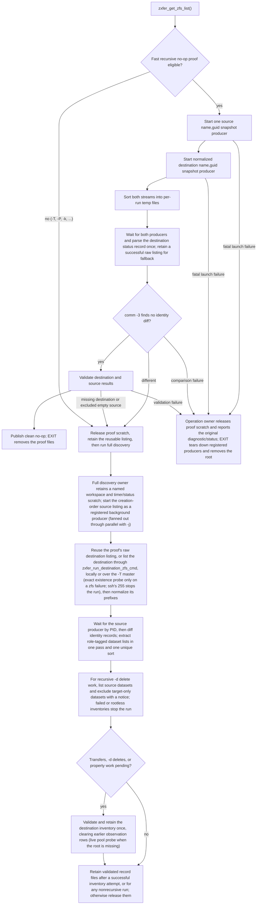
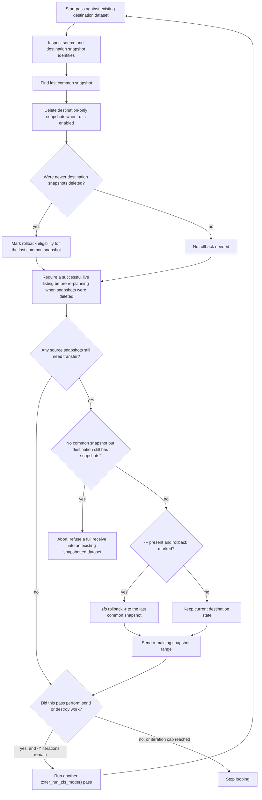
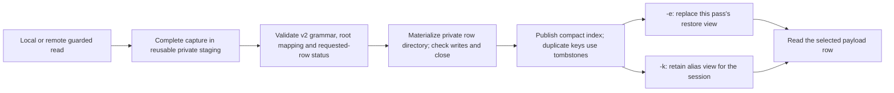

# Architecture

## Entry Point

- [../zxfer](../zxfer): top-level launcher and CLI entry point

The entry script sources only
[../src/zxfer_modules.sh](../src/zxfer_modules.sh). That loader owns runtime
module order for the launcher, `tests/test_helper.sh`, and other
direct-sourcing fixtures, so the flat `src/` layout keeps one canonical source
sequence.

## Follow One Run

Read the orchestration in three lifetimes: **session → pass → dataset**.
Discovery, planning, properties and transport perform the work each lifetime
needs. Their mechanism details are reference material below; the
[developer walkthrough](./developer-walkthrough.md) follows one concrete run.

| Lifetime | Entry points | State that survives |
| --- | --- | --- |
| Session | `zxfer_main`, `zxfer_session_run`, `zxfer_trap_exit` | Validated options, endpoint policy, trusted helpers, temp-root provenance, SSH masters and owned process handles |
| Pass | `zxfer_run_zfs_mode_loop`, `zxfer_run_zfs_mode` | Completed discovery records, dataset inventories, property caches and the send/destroy marker read by `-Y` |
| Dataset | `zxfer_process_source_dataset` | Selected prepared snapshot plan and source slice, guarded delete/transfer work and property changes; receive completion can outlive the call under `-j` |

### Session

The launcher loads the canonical manifest. Session resets inherited owner
state without acting on it, registers cleanup traps, resolves trusted helpers,
parses options and prepares endpoints. At shutdown it stops owned jobs and
helpers before closing SSH masters and releasing temporary storage, restores
pending migration services, then emits profiling and failure output.

### Pass

Replication validates roots and prepares backup storage. A dry run takes a
preview-only branch without live discovery. A live pass loads `-e` metadata
when requested, discovers snapshot identities and inventories, then runs any
required `-U` unsupported-property scan. Only the first pass takes the `-s`
snapshot or performs `-m` preparation; replication coordinates service
stopping, mount checks, unmounts,
snapshot creation and rediscovery, using migration services for stop/recovery.

Replication numbers datasets and prepares their snapshot plans and source
slices once. The snapshot-only `-g` preflight refuses divergence and protected
delete candidates before any destination mutation, then the ready queue runs.
Once jobs finish, replication reconciles seeded datasets' properties and
publishes buffered `-k` metadata. Services
stopped for `-m` restart at pass end. `-Y` repeats only when send/destroy work
occurred, up to its configured limit; the session publishes final `-k` rows.
The service restart queue is the pending-work state. Stop and restore retain
literal service arguments in their function positional parameters; failed
restores keep only failed services queued, with a guard against retry at exit.

### Dataset

Map the destination and load its prepared snapshot plan. Enforce name-and-GUID
identity, divergence and retention guards, then perform requested `-d` deletes.
Verbose reporting explains older missing identities outside the checked send
range; diagnostic plan rows cannot authorize a send or an older live anchor.
Reconcile requested properties, then re-plan from live destination state if
this run deleted snapshots. Roll back only under the existing `-F`
guards, seed a missing or snapshot-less destination when allowed, and send the
remaining range. A seed queues another property pass after receives finish.
The ready queue serializes conflicting destination ancestry while allowing
independent datasets to use available `-j` slots.

## Module Reference

The `src/` tree is flat and grouped by responsibility. The main flow stays in
the module that performs the work; small state updates do not need a separate
module or a chain of setters.

- [../src/zxfer_modules.sh](../src/zxfer_modules.sh): canonical loader and
  source-order entry point for the runtime modules; the modules below are
  listed in its manifest order
- [../src/zxfer_path_security.sh](../src/zxfer_path_security.sh): owner, mode
  and inode read from one `ls -ldin` line, the effective-UID memo, the
  single-subshell TMPDIR candidate check, and symlink-aware trusted-path
  validation for the backup metadata and `ZXFER_ERROR_LOG` paths
- [../src/zxfer_quoting.sh](../src/zxfer_quoting.sh): literal token splitting,
  single-quote escaping, and argv-to-shell rendering primitives; the
  line-control constants, `zxfer_split_begin`/`zxfer_split_end`, and the
  `*_into_result` helpers run in the current shell without command
  substitutions
- [../src/zxfer_reporting.sh](../src/zxfer_reporting.sh): structured failure
  reporting and its validated `ZXFER_ERROR_LOG` append, report-value
  escaping, verbose output helpers, usage errors, and operator-facing status
- [../src/zxfer_profile.sh](../src/zxfer_profile.sh): the `-V` counters
  (plain globals that each producer bumps inline and the session reset
  zeroes first), the attribution rules for zfs and ssh calls, stage timers
  that read the clock in the current shell, and the end-of-run summary
- [../src/zxfer_exec.sh](../src/zxfer_exec.sh): the single `eval` site that
  runs a rendered command (`zxfer_execute_rendered_shell_command`), the
  once-per-process choice of background isolation (`setsid`, shell job
  control, or the cleanup wrapper), background shell spawning, and the
  process-group signals; it has no remote-capability or snapshot-state
  dependency
- [../src/zxfer_dependencies.sh](../src/zxfer_dependencies.sh): secure PATH
  computation, in-shell required-tool lookup (`zxfer_find_tool_in_path`,
  executable regular files only), helper command defaults, and resolved-path
  normalization and validation; it does not coordinate remote lookup
- [../src/zxfer_runtime.sh](../src/zxfer_runtime.sh): TMPDIR selection, the
  validated per-run temp root, runtime artifact allocation/reuse/readback, and
  short-lived cleanup-PID rows. Default selection publishes the path validator's
  candidate result directly for runtime and short SSH socket directories;
  named file workspaces share exclusive allocation and batched release,
  with an explicit exception for a published cache
- [../src/zxfer_ssh_transport.sh](../src/zxfer_ssh_transport.sh): validated
  host/wrapper parsing (`-O`/`-T` host specs parsed once per value), the ssh
  policy validated once per run, ssh argv assembled per call with the role's
  control socket and the remote command retained in dispatcher scratch,
  direct argv invocation versus rendered shell-pipeline
  channels, the csh-safe `sh -c` rendering, an argv-preserving zfs role runner
  and renderer, active remote ZFS routing, and the per-run control sockets
  with the short socket directory it creates and removes when a long TMPDIR
  would pass the `sun_path` limit. Renderers publish the canonical quoting
  result (`g_zxfer_shell_command_result`), including csh-safe programs and
  backup dry-run previews; callers retain it before any further rendering.
  Wrapper-aware preparation still encloses the whole remote
  pipeline in `sh -c` before the dispatcher adds `doas` or `pfexec`.
- [../src/zxfer_remote_hosts.sh](../src/zxfer_remote_hosts.sh): local/remote CLI
  command-head resolution and quoting, remote helper resolution, one fail-closed capability probe per host and requested tool
  set, kept for the run in one in-memory slot per role (origin, target), either
  of which answers a lookup for the same host and tools, resolved remote
  OS/tool selections, and the option gate of the fast no-op proof; it
  consumes the SSH transport API but does not own transport state
- [../src/zxfer_cli.sh](../src/zxfer_cli.sh): option defaults, `getopts`
  parsing, local `-z`/`-Z` command preparation before any SSH connection,
  and the combination checks of `zxfer_consistency_check`, which
  also runs the `-o` reader of the property transfer module
- [../src/zxfer_destination_state.sh](../src/zxfer_destination_state.sh): the
  in-shell destination existence probe, the validated destination dataset
  inventory and a linear cache of later observations (their only writer),
  fork-free source-to-destination dataset mapping, and the depth-1 live
  listing of a dataset this run changed
- [../src/zxfer_backup_metadata.sh](../src/zxfer_backup_metadata.sh): the
  `-k`/`-e` property backup metadata module: exact-keyed storage layout, the
  local and rendered-remote directory/write/read/storage-listing protections,
  rows buffered in memory and published at completed property checkpoints and
  run end, per-dataset forwarded provenance (each alias read at most once per
  run), and the `-e` restore lookup: the file is validated once per live
  pass, before discovery. Both readers build the same compact index and
  private payload files; each dataset reads only its selected row
- [../src/zxfer_property_state.sh](../src/zxfer_property_state.sh): the
  name-list property parser (`ZXFER_PROPERTY_NORMALIZE_AWK`: per-dataset merge
  and recursive prefetch, trusting only a unique-headed run of one-line
  records from the first line), lone re-reads of every other property, the
  row store (one file per property list in a private directory under the run
  root) and the per-iteration property tables that index it, with targeted
  destination invalidation, live normalized lookups, argv decoding, and
  required creation-time property backfill. Reads reuse one private workspace
  stem (the skeleton) and its `.machine`, `.human`, `.error` and `.wanted`
  siblings; the row directory has its own lifetime
- [../src/zxfer_property_transfer.sh](../src/zxfer_property_transfer.sh):
  the property pass: readonly and noninheritable defaults, the `-o` reader
  (CLI validation prepares the override policy before any zfs command;
  a malformed item or a property named twice is a usage error), the
  readonly policy prepared after endpoint initialization, the `-U` destination-support scan,
  source collection (with `-e` restore) and create-time metadata, one plan
  `awk` per dataset (derive the apply and creation lists with the
  readonly/`-I`/`-U` filters, validate all creation constraints, then use named
  root/child decisions over ordered encoded records and first-provenance maps
  to emit selected actions), destination creation, set/inherit execution, child-inherit
  adjustment, and the linear per-dataset `zxfer_transfer_properties` flow
- [../src/zxfer_snapshot_discovery.sh](../src/zxfer_snapshot_discovery.sh):
  source and destination listing commands and their registered background
  producers, destination-listing normalization, the fast no-op proof and full
  discovery (a `-T` destination is listed like a local one), diffing, the
  record files planning reads, and the work lists (the only writer of the
  source, source-inventory and destination-delete lists, including the `-N`
  and `-n` lists)
- [../src/zxfer_migration_services.sh](../src/zxfer_migration_services.sh):
  Solaris/illumos SMF service stopping, restart and recovery. Replication
  coordinates `-m` preparation and calls these service operations; this module
  does not call back into replication
- [../src/zxfer_send_receive.sh](../src/zxfer_send_receive.sh): pipeline
  construction and dispatch, the `-D` progress stage, compression and ssh
  wrapping, job limits and destination-ancestry serialization, status-file
  completion, receive finalization and bounded abort handling. Pipelines are
  rendered in the current shell so a `-j` job shell needs no zxfer function
- [../src/zxfer_snapshot_plan.sh](../src/zxfer_snapshot_plan.sh):
  pass-level grouped snapshot planning (common snapshot, transfer range,
  capped divergence summary, and file-backed `-d` delete records), with one
  keyed sort and one shared planner traversal per queue. Source slices support live rechecks using the
  same algorithm; malformed identity is deferred to the dataset boundary.
  It also owns one batched creation-time query
  per delete plan that decides rollback eligibility and `-g`, deletion with
  its safety rechecks, the divergence contract, the live re-plan of a dataset
  whose `-d` destroy ran, and reusable run-scoped plan, creation-time and
  slice scratch files. `zxfer_publish_snapshot_transfer_plan` is the only
  writer of the published plan; a seed receive records its new anchor
  through it
- [../src/zxfer_replication.sh](../src/zxfer_replication.sh): the pass roots,
  `-m` preparation (service stopping, mount checks, source unmounts, snapshot
  and rediscovery),
  the `-s`/`-m` snapshot (and the flag that keeps later `-Y` passes from
  taking it or repeating the `-m` preparation), the numbered dataset
  iteration list, the `-g`
  pre-pass, the rollback, seed and send of each dataset, its failure stage,
  the post-seed property pass, the per-pass send/destroy marker used by `-Y`,
  and orchestration across discovery, planning, and transfer
- [../src/zxfer_session.sh](../src/zxfer_session.sh): final composition root for
  owner resets, CLI-to-execution-context startup, remote connection
  preparation, trap registration, ordered shutdown, and top-level execution

[../src/zxfer_cleanup_child_wrapper.sh](../src/zxfer_cleanup_child_wrapper.sh)
is not in the manifest: it is the standalone script a background shell runs
under when the host offers no process-group isolation (see below), and the
one the `-D` progress dialog always runs under.

## Session Startup And State Ownership

The startup path is intentionally explicit:

1. [../src/zxfer_modules.sh](../src/zxfer_modules.sh) loads the flat module
   stack in one canonical order without source-time initialization.
2. `zxfer_reset_session_state()` in
   [../src/zxfer_session.sh](../src/zxfer_session.sh) calls each module's
   owner reset once, in a fixed order, and only assigns. It resets dependency
   commands first (`zxfer_reset_dependency_state()`), because the ssh and
   remote-host resets read `g_cmd_ssh` and `g_cmd_zfs`. Inherited process,
   SSH, path, and migration-service handles are dropped without acting on
   them, so an exported `g_*` value can never grant cleanup ownership, and
   the effective-UID and ssh-policy memos start empty, so an exported value
   can never stand in for `id -u` or a validated policy.
3. `zxfer_session_initialize()` points `g_cmd_awk` at the awk on the built-in
   secure PATH, installs the EXIT and HUP/INT/QUIT/TERM traps, then runs
   `zxfer_init_session_environment()`: secure PATH, `ZXFER_BACKUP_DIR`,
   required helpers (awk, zfs, ps, optional parallel; looked up in the shell
   by `zxfer_find_tool_in_path`), run temp root, then the narrowed and
   exported PATH.
4. Module-specific mutable scratch state stays with the owning module rather
   than being duplicated in the runtime layer. The main examples are
   [../src/zxfer_snapshot_discovery.sh](../src/zxfer_snapshot_discovery.sh),
   [../src/zxfer_snapshot_plan.sh](../src/zxfer_snapshot_plan.sh),
   [../src/zxfer_send_receive.sh](../src/zxfer_send_receive.sh),
   [../src/zxfer_backup_metadata.sh](../src/zxfer_backup_metadata.sh), and
   [../src/zxfer_property_state.sh](../src/zxfer_property_state.sh).
5. `zxfer_prepare_remote_host_connections()` resolves ssh, opens each remote
   role's control master through `zxfer_open_ssh_control_sockets()` (ssh
   transport), then preloads each host's capabilities over it (remote hosts),
   so no later remote command opens its own connection when control sockets
   are supported. Equal `-O` and `-T` specs share the origin's master and one
   probe.
   `zxfer_init_variables()` then looks up the local OS once
   (`g_zxfer_local_os`), runs `zxfer_init_endpoint_execution_context
   origin|target`, and resolves helper paths and platform-specific bootstrap
   details. Session copies the local safe codecs into their endpoint defaults
   before these calls. Each endpoint initializer gathers its OS, zfs path and
   codec, then publishes the complete context directly; no publication helper
   or scratch copies sit between preparation and the endpoint globals.

Command preparation flows from CLI/session to remote-host resolution, then to
dependency lookup and path validation. `zxfer_resolve_cli_command_safe()` in
remote hosts preserves the command's arguments around its resolved head;
`zxfer_refresh_compression_commands()` in CLI prepares both local codecs after
parsing, before remote connection setup. Dependency mechanisms never call back
into remote-host coordination.

Resolved executable paths and lookup diagnostics use
`g_zxfer_required_tool_result`, including path normalization and lazy local SSH
lookup. SSH keeps its durable command in `g_cmd_ssh`; a cache hit republishes
that path into the transient result channel. A quoted command with arguments
uses `g_zxfer_resolved_cli_command_result`, so it cannot be mistaken for an
executable path.

The sensitive-caller ratchets in `tests/budget_policy.tsv` cap security- and
performance-sensitive call sites, including the single hardened production
`eval` site. Module boundaries and function sizes are review decisions.
Functions use distinct `l_*` scratch names when calling one another in the
same shell because POSIX shell has no function-local variables. Shared `g_*`
state is appropriate when later phases need it; values used by one linear
flow stay in that flow. Positional parameters belong to each function call,
so an operation can retain its resources there and pass them to stages without
child helpers overwriting them. Ordinary `l_*` assignments still have shell-wide
scope; changing a prefix does not create local state. Single-caller wrappers
can be inlined when this makes the behavior easier to follow.

Property planning publishes a validated action file of tagged, encoded
create/set/inherit records and a completion marker. The dataset operation reads
that file for creation or apply; small counts stay in shell state. Snapshot planning
keeps its shared transfer and verification results, but derives destination
snapshot presence in the existing AWK batch rather than retaining a second
copy of every destination record. Restore row loading consumes the validated
metadata contents directly; the restore cache retains its roots and row index
for lookups, without a separate copy of the file contents. Table and restore
lookups publish the row reader's `g_zxfer_property_row_payload_result` directly;
their callers retain it before another lookup. The property operation keeps
its raw and effective views across later helper calls.

The stable `tests/test_helper.sh` entry point loads every module in manifest
order and owns only test lifecycle and process capture. Domain helpers such as
backup renderers and environment-driven fake tools are opt-in fixture modules
sourced only by their owning suites; this keeps fixture functions from
becoming an implicit global test API.

## Runtime Artifact Layer

All run-private transient state lives under one per-run 0700 temp root,
created with a single `mktemp -d` after TMPDIR is validated once (single-pass
physical resolution plus owner/mode checks). Allocators in
[../src/zxfer_runtime.sh](../src/zxfer_runtime.sh) hand out
`<prefix>.<counter>` children by redirection or `mkdir`; there is no per-file
registration or unregistration ceremony for contained children. A named file
workspace reserves a primary file as its stem and creates `STEM.NAME` siblings
through the same exclusive 0600 allocator. All files remain direct children
of the private root; no extra directory or allocation process is needed.
Allocation skips a family with a retained sibling, including when a subshell's
counter changes did not reach its parent, and cleans partial returned failures.
The count-based file-group API uses the same allocator. Runtime
records the exact root, validated physical parent, and a security record
(inode, owner uid, and mode 0700 plus any special bit, such as the 2700 a
set-group-ID TMPDIR gives) taken right after its own `mktemp -d`;
whole-root removal requires that provenance, one fresh record equal to it
(one `ls -ldin`, no `id` fork), and the reserved `zxfer.<pid>.*` shape.
[../src/zxfer_path_security.sh](../src/zxfer_path_security.sh) reads every
owner, mode and inode from one `ls -ldin` line (inode, mode string, link
count, numeric owner: the POSIX fields every supported `ls` prints), checks a
TMPDIR candidate in one subshell (`cd -P`, `pwd`, then `exec ls`), and asks
`id -u` at most once per run.
`zxfer_trap_exit()` in
[../src/zxfer_session.sh](../src/zxfer_session.sh) removes the whole root only
after supervised jobs, short-lived cleanup helpers and SSH control sockets
have been handled. Staged contents reload through the shared readback helper,
which keeps partial payloads out of shared `g_*` scratch state and preserves
exact nonzero readback failures for the caller. The one run-private entry
outside the root is the SSH transport's short socket directory, made (with a
random `mktemp -d` name under the default temp root) only when the run root's
socket path would pass the `sun_path` limit.
[../src/zxfer_ssh_transport.sh](../src/zxfer_ssh_transport.sh) owns it and
removes it after the sockets close, without recursion: it unlinks the two
role sockets and ssh's temporary listener names, then removes the empty
directory, and it refuses a symlink or a name it did not create.

Staging that must sit beside its target, for a same-directory atomic rename,
stays outside that layer with the module that owns the target: backup
metadata publication (0600 stage files beside the targets, atomic renames,
and a recovery copy for detected pair-publication failures) lives in
[`../src/zxfer_backup_metadata.sh`](../src/zxfer_backup_metadata.sh).

Snapshot artifacts also have narrower owners above the allocator. Full
discovery and the fast recursive no-op proof each retain a named workspace stem
and its allocated path list in distinct owner scratch. Helpers receive concrete
paths such as `STEM.error`, `STEM.sorted` and `STEM.raw` in their arguments.
The fast proof's one owner,
`zxfer_try_fast_recursive_noop_discovery`, keeps timers, PIDs and statuses in
distinct `l_fast_noop_owner_*` scratch names; its helpers never write them.
Full discovery has the same ownership model in `zxfer_run_full_snapshot_discovery`,
with four core workspace files, a raw file when the proof did not supply one,
and distinct `l_full_owner_*` timer/status scratch.
It coordinates destination collection, source validation,
publication and release directly. Substantive helpers receive their resources
explicitly; cleanup runs from one terminal path in the owner. Its destination
inventory decision also governs record retention: after a successful inventory
attempt, retain the record files; nonrecursive runs retain them even without an
inventory attempt. There is no second work predicate or cached retention flag.
Published record caches,
the raw destination-listing handoff, and the registered source PID keep their
shared ownership because later planning or EXIT teardown needs them. Validation returns its status
and diagnostic before that release. Full discovery defers release when its
source producer is unreaped; EXIT teardown stops registered producers before
removing the root. The fast proof parses its completed destination status record once,
using it both to retain a successful listing for fallback and to validate the
proof. Discovery owns the flat source/destination record files
that survive for later lookups. The snapshot plan module owns a reusable plan
file, a reusable creation-time file and a reusable slice file, the
destination-state module the reusable depth-1 listing file, and discovery a
reusable destination-listing stderr file; all five are reused
for the whole run (across datasets or passes), are not cleared by a
per-dataset state reset, and are reused only when they lie under the run's
private temp root.
`zxfer_ensure_runtime_artifact_file` in runtime reuses or allocates their paths
through the same artifact-path result. Each domain keeps its durable path;
runtime does not adopt its lifecycle. A live destination listing's path remains
available after failure for reuse, so planning consumes its contents only after
the listing succeeds. Cache lookup and live existence probes share one result,
consumed immediately. The validated inventory is retained once; later
observations are prepend-only `state<TAB>dataset` rows. Lookup checks the
newest observation first, then literal inventory membership, then the missing
default under a complete inventory root. A receive clears that default so
unlisted descendants are live-probed; explicit observations and listed names
remain usable. A new inventory clears old observations.

The SunOS fallback uses one parent-to-pool loop for silent or whitespace-only
exact-probe failures. A listing that names the requested dataset proves it
exists. Absence requires a successful listing naming the probed parent while
omitting its child, or a recognized missing-dataset diagnostic. Only an ambiguous
failure advances to another ancestor. Finding a higher ancestor's child does not prove the
original destination absent. If the walk cannot prove absence, the first
parent's diagnostic is retained and replication stops before mutation.

`zxfer_build_replication_iteration_list` prepares the full dataset queue once
per live pass, including property-only work. `zxfer_prepare_snapshot_plans`
keys both record files by queue position and sorts the keyed rows. Its grouped
consumer uses the same planning algorithm as a single live recheck, writing
`BASE.N.p` (prepared plan) and `BASE.N.s` (source rows, newest first). The key
index holds one entry per queued dataset; planner arrays hold only the current
dataset's snapshots and are cleared between groups with POSIX entry deletion.
Two files are open at a time, under umask 077. No destination input slice is
needed after its plan is prepared. Plans retain exact common/pending identities
and ordered deletion records on disk. A fixed-order summary block follows them:
range endpoints, destroy argument, destination presence, source count and
divergence count, then an explicit completion marker at EOF. Whole-line reads
preserve empty values and literal record tabs without shell evaluation. The
loader rejects partial blocks, invalid counts/presence and trailing data, and
starts no AWK process for a prepared plan. The shell loads range endpoints, source
count, destination presence, a divergence count with at most three examples,
and the single destroy argument; it does not rebuild snapshot lists. The
planner no longer stores a pending-record array. Creation-time queries read
only tagged deletion records, in batches of at most 128 paths (common first),
and grandfather protection considers them in their original order. The destroy
argument retains the reverse deletion order and remains one command.

The snapshot-only `-g` preflight projects its original delta-list ordering onto
those queue positions, excluding property-only work. Preflight and execution
load the same immutable plans without launching a planner per dataset. A
GUID-less row records `error<TAB>3` in its dataset's plan instead of aborting
preparation: normal execution reports it when that dataset is reached, after
any earlier successful transfers; `-g` reports it before any mutation. File or
preparation failures publish no pass plans. Plans are used only while source,
destination and record-file provenance match. Every `-Y` pass rebuilds them.
Unselected callers and explicit live destination listings use the single-
dataset driver of the same algorithm. Active common/first/final records and
their eligibility-file path are published separately, so a live verification
cannot overwrite them. Two reusable scratch plans alternate when a direct
caller's active plan occupies one; prepared plans remain immutable. This bounds
scratch-file retention across passes without copying active record payloads.

Before each send, only a dataset whose snapshots this run's `-d` destroy
changed is listed again: `zxfer_reconcile_live_destination_snapshot_state` in
the plan module lists it at depth 1 through
`zxfer_get_live_destination_record_file` and re-plans it with
`zxfer_plan_dataset_snapshots`. Every other dataset
keeps the plan made from discovery. A common snapshot older than the
inspected anchor is never adopted. A candidate must exactly match an original
common/send record, including its GUID; falling between the range endpoints
is insufficient. If none matches, the range begins at the old anchor and is
republished without a common snapshot, so the seed refuses a snapshotted destination,
or re-seeds an emptied one from the anchor with `-F`. Before a full receive
into a dataset the existence cache calls missing, the seed probes it live once
more. A change another tool makes to the destination after discovery is not
seen until the next pass: an incremental receive whose base was pruned fails
without changing the destination, and a full receive refuses a dataset that
has gained snapshots. The post-receive divergence check also lists its
dataset at depth 1.

`zxfer_zfs_send_receive` prepares and dispatches the pipeline directly.
Wrapped transfers publish `g_zxfer_shell_command_result`, including the local
compression or decompression stage. The operation retains its send and receive
commands before another renderer or progress preparation can replace that
result. Each wrapper retains its input before clearing the shared result;
failed preparation leaves the result empty and preserves the builder's status.
Parallel send/receive scheduling and supervision live alongside it in
[../src/zxfer_send_receive.sh](../src/zxfer_send_receive.sh). Each running job has
one registry row containing its ID, PID, destination, status-file path,
snapshot, and cleanup scope. The job shell records its exit status in the
private status file. The parent polls all active jobs and reaps every finished
job in one scan, each reap reading stdin from `/dev/null`, so a later
completion can free a slot before an earlier job finishes; missing or invalid
status fails closed. Send/receive and `-D` stages are rendered in the main
shell as plain shell, so job shells need no zxfer functions. Source discovery
is simpler: it waits directly on its registered helper PID and checks the
command's status.

[../src/zxfer_exec.sh](../src/zxfer_exec.sh) selects background isolation once.
A working `setsid` is preferred; shell job control is feature-tested when
there is no controlling terminal, and only where it also isolates jobs
started from a subshell (bash; FreeBSD sh, dash and ksh93 use the wrapper when
`setsid` is unavailable). Job shells run `/bin/sh`. Both paths require a
process group whose ID is the spawned child's PID. Otherwise
[../src/zxfer_cleanup_child_wrapper.sh](../src/zxfer_cleanup_child_wrapper.sh)
provides bounded direct-child cleanup and token-validated descendant cleanup.
Abort sends TERM, allows a bounded grace period, then escalates with KILL and
reaps. Group cleanup covers pipeline stages even when the job-shell leader
has already exited. A job that has recorded its exit status gets only a
process-group signal, and the bare-PID fallback is used only while the PID is
still in zxfer's own process group, so a recycled PID is never signalled.
After a failed wait, discovery signals only a pgid-scoped producer's group and
never the reaped PID, whose number may have been recycled. In wrapper mode,
stages that outlive the reaped wrapper are reparented and are not stopped.
Normal completion avoids process-table snapshots. Every group probe and
signal goes through `zxfer_signal_process_group`, which uses the signal-first
`kill -SIG -PGID` form: it is the one form dash, bash 3.2, ksh93, FreeBSD sh
and BusyBox ash all read, while `kill -s SIG -- -PGID` makes BusyBox ash exit 1
after signalling the group.

The fallback wrapper uses ancestry snapshots, which cannot contain an
arbitrary descendant that forks and escapes before the next snapshot. A
descendant is signalled only when its current start token is readable and
matches the recorded one. One whose token changed or cannot be read counts as
stopped only when it no longer takes signals or `ps` reports it as a zombie.
Process-group isolation provides stronger containment for pipelines that
remain in their assigned group. Shells may reap children internally before
an explicit `wait`, so retained PID records alone are not a universal
protection against PID reuse. Cleanup failures propagate through the session's
structured failure path, including managed SSH control-socket close failures.
Short-lived helpers use the same spawn scopes and the runtime cleanup registry.

## Error Log Append

zxfer takes no cross-process locks. The only file that concurrent runs share
is the operator's `ZXFER_ERROR_LOG`, and
[../src/zxfer_reporting.sh](../src/zxfer_reporting.sh) appends each failure
report to it with one `O_APPEND` write, which the kernel places at the end of
the file as a unit. Before every append it checks the path (absolute, no
symlinked component, a trusted parent, a regular 0600 file with a single
link, owned by root or the effective user); a missing log is created under
umask 077 with noclobber and set to mode 0600 only after those checks pass.
The write goes through awk rather than the shell's `printf`: bash
line-buffers its builtins' output, so a report printed by the shell would go
out one line per write and could interleave with another run's report. A
report larger than awk's output buffer (usually the file system block size)
still takes more than one write, and NFS does not keep appends whole;
[../SECURITY.md](../SECURITY.md) lists these residual races. No lock
directory, lease entry or cache file exists: ssh control sockets and remote
capability state are per-run and need no cross-process coordination.

## Remote Protocol Rendering And Capability State

Remote capability probes and the secure backup directory/write/read and
`-O` storage-listing protocols, including their shared prelude and symlink
walk, are assembled as readable multiline POSIX `sh` programs. Backup programs
use literal bodies preceded by short argv-quoted input initializations, so
their runtime quoting can be read directly without interpreting a second
shell's expansion. Each backup renderer initializes its quoted inputs, then
passes a literal here-document to the shared body emitter,
`zxfer_print_backup_script_body`. It uses shell builtins to preserve blank lines
and shell syntax without expanding the body or adding a helper process. It
reads only the renderer's here-document, leaving metadata stdin for the rendered
program. Capability probes quote their PATH and tool inputs in the renderer. The programs' stages, quoting, status values, and publication topology
are reviewable directly and pinned by golden fixtures. The SSH
transport uses one mode-and-role dispatch for local or remote ZFS commands,
retaining direct local argv execution and named source/destination wrappers.
The dispatch consumes its selected endpoint directly instead of publishing
intermediate role fields. It retains the established rendering for short,
single-line scripts.
For long or multiline scripts it places bounded, quoted data chunks on one
physical login-shell command line; a fixed POSIX `sh` bootstrap reconstructs
the exact program before the explicit `sh -c` handoff. This keeps individual
words below the illumos csh lexical limit while preserving standard input and
the program's exit status.
Remote zfs commands are rendered from argv; when an argument contains a
newline the command uses the same chunked form, so argument boundaries,
including empty arguments, survive a csh login shell.
`ZXFER_SECURE_PATH`, `ZXFER_SECURE_PATH_APPEND`, resolved helper paths, and
`ZXFER_BACKUP_DIR` reject tab, carriage-return, and line-feed bytes before that
rendering, so transport compatibility cannot translate trusted configuration.

One accepted capability response is parsed once and checked for framing,
requested-tool coverage, duplicate records, statuses, and helper-path shape.
Only then are the OS and validated tool records stored in that role's slot,
keyed by host and requested tool set. The slots retain no raw wire response;
ZFS status remains in its tool record. Later OS and tool lookups select either
role's matching slot and consume its fields directly, without copying them
into active parser scratch or running another probe or parse: a probe depends only on the host spec and
the scope, and equal `-O` and `-T` specs ask the same scope (the union of
both roles'), so that host is probed once. A failed probe or a response that
fails validation fills no slot, and its caller falls back to a direct probe.
A tool outside the host's scope is probed as "zfs TOOL", and a tool without
a record gets one direct probe. Secure PATH and ssh policy cannot change
within a run, so they are not part of the key.

## Recursive Property Prefetch

Property policy is fixed for the session: CLI validation stores the parsed
`-o` list separately from parser scratch results, and endpoint initialization
prepares the readonly list for the destination platform and `-m`. Dataset
processing and repeated `-Y` passes consume those policies. A `-U` scan resets
only its support lists; session reset discards both policies, including any
inherited values.

`zfs get -H` prints property values raw, and a value may hold TAB and LF, so
a value line can look exactly like another record. Every `zfs get all` read
therefore takes the machine (`-Hpo`) and human (`-Ho`) views first and then
lists the record keys alone: `zfs get -H -o property all DS` per dataset, or
`zfs get -r -t filesystem,volume -H -o name,property all ROOT` for the
recursive prefetch (snapshot and bookmark rows never enter the capture).
Names hold neither TAB nor LF, so the list is unambiguous, and reading it last
means a dataset or property removed between the calls is never listed. Each
status is checked; a failed or rejected tree read falls back to per-dataset
reads.

The parser (`ZXFER_PROPERTY_NORMALIZE_AWK`, run behind the shared
`ZXFER_PROPERTY_AWK_LIB` helpers like every property `awk` program) accepts
record i only in an unbroken run from line 1: lines i and i+1 start with keys
i and i+1, and no other line starts with either key. The value runs from the
key's TAB to the line's last TAB, since a source holds none. A malformed or
repeated list row fails the read closed. The prefetch stores merged
payloads only for wanted datasets (one name per filter line) whose every
record is in the run in both views; the rest take the per-dataset path,
which re-reads every property after the run alone
(`zfs get -H[p]o property,value,source -- PROP DS`, where `--` keeps a user
property name that starts with `-` from being parsed as an option, split at
its last TAB). A multi-line value therefore costs two extra `zfs get` calls
for each later property of that dataset, and in a recursive read sends every
later dataset to per-dataset reads. A user property that a lone re-read
reports with source `-` was removed after the name list and is left out, as
if the read had begun after the removal (a set user property never has that
source; native properties keep it). Two races remain (see
[../KNOWN_ISSUES.md](../KNOWN_ISSUES.md)): a wanted dataset destroyed before
the value views and recreated (or renamed away and back) before the name list
can take values forged by the value printed before it, native properties
included; and a user property created between the value views and the name
list takes its value and source from the user property value printed just
before it, which is published cut at its first line feed.
Property reads reuse five per-run scratch files (name list, machine view,
human view, zfs stderr, prefetch dataset filter); no intermediate grouped file
is read back. Each property list goes to its own row file in one private
directory under the run root (the row store): the prefetch parse writes its
rows in the same `awk`, and a live read stores its list as the newest row.
Each side's table is an index of `ROW<TAB>DATASET` lines, newest first, so a
lookup takes the dataset's first index line and reads that row alone,
whatever the size of every other list; a row file that is missing or lacks
its final line feed is a miss, which only forces a live read. The `-e`
restore rows live in the same directory (prefix `r`, one index line per
relative key), stored when each live pass validates the backup file. A
destination receive puts a tombstone line ahead of the dataset's rows, and a
create, set or inherit also strips its descendants' lines.

The dataset property operation owns its original source view (for `-k`),
effective restored/backfilled view, and completed plan. Collection no longer
publishes separate raw/effective globals. The planner's internal API takes six
dataset inputs: initial-root flag, destination-exists flag, type, source view,
destination view and unsupported-property policy. Both flags are explicit 0/1
values; an empty destination view still represents an existing dataset when
its flag is 1. Run-wide `-P`, validated `-o`, readonly and `-I` policies come
from session state rather than being repeated in each call. The operation
retains destination values across helper calls alongside its source views.
The property planner reads
encoded source, destination and override lists from one reusable private input
file; only its path crosses the environment. One batched AWK writes selected
create/set/inherit action records, retaining the first source and override value
needed for late parent reconciliation. A checked close and final record precede
publication of the small action/override counts. Full diagnostic CSV views are
retained only under `-V`; ordinary runs never transport six result lists.

The operation retains its plan path while parent reads replace shared read
results. One parent-resolution AWK rewrites a reusable work file with explicit
creation and reconciliation rules: child creation drops an inheritable override
only if the actual parent supplies its value; existing-child reconciliation also
preserves matching inheritable override requests. Reads still occur after prior
mutations and cache invalidation. It processes original sets before inherits to
preserve each resulting command order. Working memory is limited to the current
dataset; the three scratch files are reused across datasets and passes, and the
run root owns their release.

One command consumer decodes selected rows into individual arguments for create
and the single batched set, then executes ordered individual inherits. It keeps
`create -p` property-free, volume sizes explicit, remote argument boundaries,
and mutation invalidation. `-v`/`-V` diagnostic lists are reconstructed only for
display. Raw/effective property reads, capture, and backup format v2 are unchanged.

## Execution Lifecycle Diagrams

The following Mermaid diagrams describe the current execution path through the
launcher plus the main orchestration modules. They intentionally use the real
function boundaries so operators and contributors can line the diagrams up with
[`../zxfer`](../zxfer),
[`../src/zxfer_runtime.sh`](../src/zxfer_runtime.sh),
[`../src/zxfer_ssh_transport.sh`](../src/zxfer_ssh_transport.sh),
[`../src/zxfer_remote_hosts.sh`](../src/zxfer_remote_hosts.sh),
[`../src/zxfer_destination_state.sh`](../src/zxfer_destination_state.sh),
[`../src/zxfer_snapshot_discovery.sh`](../src/zxfer_snapshot_discovery.sh),
[`../src/zxfer_snapshot_plan.sh`](../src/zxfer_snapshot_plan.sh),
[`../src/zxfer_property_state.sh`](../src/zxfer_property_state.sh),
[`../src/zxfer_property_transfer.sh`](../src/zxfer_property_transfer.sh),
[`../src/zxfer_send_receive.sh`](../src/zxfer_send_receive.sh),
[`../src/zxfer_replication.sh`](../src/zxfer_replication.sh), and
[`../src/zxfer_session.sh`](../src/zxfer_session.sh).

### General Run Lifecycle

This is the end-to-end path for one `zxfer` invocation, including remote
bootstrap, one or more replication passes, and trap-driven shutdown.

```mermaid
flowchart TD
    A["User invokes zxfer"] --> B["Early bootstrap: trusted PATH allowlist and the -h and -V prescans"]
    B --> C["Source zxfer_modules.sh to define the pure loader"]
    C --> C1["Call zxfer_load_modules() for the canonical manifest, then capture the invocation"]
    C1 --> D["Reset session state with zxfer_reset_session_state()"]
    D --> D1["Bootstrap awk from the built-in secure PATH"]
    D1 --> D2["Register zxfer_trap_exit() for EXIT and signals"]
    D2 --> D3["Run zxfer_init_session_environment()"]
    D3 --> E["Parse flags and prepare local codecs in CLI with zxfer_read_command_line_switches()"]
    E --> F["Validate combinations and prepare the -o policy with zxfer_consistency_check()"]
    F --> G["When -O or -T is configured: open each role's ssh control master (a -T spec equal to -O shares the origin's; sockets go under the run root, or a short zxfer.ssh.XXXXXX directory when a long TMPDIR would pass sun_path), then probe each remote host's capabilities once over it into in-memory state"]
    G --> H["In session: set local codec defaults, prepare and publish each endpoint with zxfer_init_variables(), then prepare destination readonly policy"]
    H --> I["Enter zxfer_run_zfs_mode_loop()"]
    I --> J["Start one pass in zxfer_run_zfs_mode()"]
    J --> K["Resolve source and destination, reject control characters, validate preconditions"]
    K --> L["Name the -m snapshot first, then prepare the ZXFER_BACKUP_DIR root when -k is enabled (dry runs preview it)"]
    L --> M{"Dry run?"}
    M -- "yes" --> N["Preview-only path: seed a minimal source list and skip live discovery"]
    M -- "no" --> O["Initialize live replication context"]
    O --> P["Optional -e restore metadata load before discovery"]
    P --> Q["Run zxfer_get_zfs_list() to cache source and destination state"]
    Q --> Q1["Source snapshot listing runs as a tracked background helper and later waits by PID"]
    Q1 --> R["Optional unsupported-property probing when -U has later work to filter"]
    R --> S["First pass only: optional preflight snapshot via -s or migration prep via -m"]
    S --> U["Run zxfer_copy_filesystems()"]
    N --> V{"Repeat pass?"}
    U --> U1["Number queue; prepare range summaries, exact identities and source slices in one traversal"]
    U1 --> T["-g preflight: load snapshot-work plans in original order, refuse divergence and protected deletes before execution"]
    T --> W["Fill a ready queue with background send/receive jobs, skipping blocked destination descendants while independent work exists"]
    W --> X["Reap completed send jobs, then run deferred post-seed property reconcile"]
    X --> Y["Relaunch services after -m if needed"]
    Y --> V
    V -- "yes: -Y and send/destroy work occurred" --> J
    V -- "no" --> Z["Invoke the final -k backup metadata write (a dry run buffers no rows and only notes the skip)"]
    Z --> AA["Normal exit path"]
    AA --> AB["zxfer_trap_exit(): abort owned jobs/helpers, close SSH sockets, remove the ssh socket directory and the proven run root, restore migration services, then emit profiling and structured failure output"]
```



### Snapshot Discovery And No-Op Proof

`zxfer_get_zfs_list()` owns the initial source and destination view used by
later delete, seed, send, and property decisions. Snapshot records stay
identity-aware at this layer: source and destination snapshot lists use
`zfs list -Hr -o name,guid -t snapshot`, and destination records are normalized
by rewriting only the leading destination dataset prefix.

For eligible recursive runs — local sources and remote-origin `-O` pulls
alike — `zxfer_try_fast_recursive_noop_discovery()` attempts a
clean no-op proof before the heavier creation-order source discovery path.
Eligibility is intentionally narrow
(`zxfer_fast_recursive_noop_options_are_eligible`): `-R` must be active, `-T`
must be absent, and snapshot creation, migration, property transfer or
restore, backup metadata, and property overrides must be inactive.
The proof starts one recursive source `name,guid` producer even when `-j` is
configured, starts one normalized destination `name,guid` producer, sorts both
streams into regular files under the per-run temp root, and treats a non-empty
`comm -3` diff as a mismatch. `-U` unsupported-property filtering and `-g`
grandfather protection can remain enabled because a proven no-op leaves no
source transfer queue, destination delete queue, or property/create work to
consume those checks. A mismatch, missing destination, excluded-dataset
uncertainty, or stream failure falls back to full discovery or fails through the
same staged stderr paths used by the normal discovery flow. A proven clean no-op
never runs the creation-order source listing. When the proof declines after a
successful destination listing, full discovery normalizes that raw listing
instead of listing again. A full-discovery listing checks destination
existence only when the listing itself fails. The destination producer writes
one status line for its list, normalize, and sort stages.

A `-T` destination takes the same full-discovery path as a local one. Every
destination `zfs list` goes through `zxfer_run_destination_zfs_cmd`, which
runs it on the target over the role's ssh control master, and each listing's
own exit status gates its output file (ssh exits 255 when the connection
drops), so there is no target-side script or framing protocol to validate.
The destination snapshot listing overlaps the source listing; when it fails,
the exact existence probe decides between a missing dataset (bootstrap) and
a failed run. A `-T` listing that ssh could not deliver (status 255, which
zfs never returns) says nothing about the dataset, so the run stops with
that status without probing over the same connection. After the diff, the
recursive dataset inventory is listed only when later work reads it
(transfers, `-d` deletes, property work), so a clean `-T` no-op lists no
inventory; a missing destination root is bootstrapped only after the live
pool probe lists its pool. Snapshot-list stderr precedes the `Failed to
retrieve snapshot list from the destination.` report, locally and over `-T`.

Delta processing extracts transfer datasets, extra destination datasets and any
needed full-source inventory in one AWK pass. Fixed role tags keep those lists
independent through one C-locale unique sort; the current shell publishes each
list without splitting names on spaces. Empty recursive work skips extraction
entirely. Record exclusions retain AWK's regex semantics and dataset exclusions
retain grep's regex semantics. Snapshot identity validation and the live-source
inventory guard for `-d` still precede any destructive work.

Source listing builders publish the canonical `g_zxfer_shell_command_result`.
The producer launcher retains the completed command before further rendering,
and `g_source_snapshot_list_cmd` keeps it for a later failure report. A failed
builder preserves its diagnostic or empty result and status; partial render
output is cleared. Parallel accounting follows the selected producer: the fast
proof always runs one recursive listing, while a successful full listing uses
parallel exactly when `-j` exceeds one. No separate parallel-use flag is kept.
Both source launchers use `zxfer_start_source_snapshot_producer`: the fast
pipeline optionally filters exclusions and counts presence, while the full
pipeline tees creation-ordered output. They share sort, ordered stage-status
validation, command recording, spawn and cleanup registration. Status files
retain their existing private allocation and lifetime; the first failed or
unreadable stage wins over sort's status. Listing builders still own compressed
and parallel success sentinels, and source/destination discovery still overlaps.



### Per-Dataset Replication Lifecycle

Each dataset in the iteration list flows through one orchestration pass in
`zxfer_process_source_dataset()`. This is the core lifecycle inside
`zxfer_copy_filesystems()`.

```mermaid
flowchart TD
    A["Start zxfer_process_source_dataset(source) with failure_stage replication"] --> B["Map source to actual destination and select its prepared plan"]
    B --> C["Validate and load the prepared summary without AWK; report deferred identity failures at this dataset boundary"]
    C --> D["Load common snapshot, first/final pending records and capped divergence summary"]
    D --> D1["Refuse destination snapshots that share a source snapshot's name but not its guid, unless -d and -F are both set (then warn and converge)"]
    D1 --> E{"-d enabled?"}
    E -- "yes" --> F["Read ordered delete records; query creation times in 128-path batches (-g and rollback), then issue one destroy"]
    E -- "no" --> G{"Property pass required?"}
    F --> G
    G -- "yes" --> H["Run zxfer_transfer_properties() under failure_stage property transfer: collect source properties, check -o against the initial source, create a missing destination or plan and apply property changes, and buffer -k metadata when enabled; then failure_stage replication again"]
    G -- "no" --> I["Skip property phase"]
    H --> J["After a -d destroy, require a successful live depth-1 listing before re-planning; require exact membership in the original common/pending identities; otherwise keep the discovery plan"]
    I --> J
    J --> K{"Any snapshots remain to send?"}
    K -- "no" --> X["Dataset pass complete"]
    K -- "yes" --> K1["With -F, roll back to the last common snapshot when the -d destroy deleted newer snapshots"]
    K1 --> L{"Need bootstrap seed?"}
    L -- "yes" --> M["Seed first snapshot into missing or empty destination"]
    L -- "no" --> N["Keep existing destination head"]
    M --> O{"More snapshots remain after seed?"}
    N --> P["Send remaining snapshot range"]
    O -- "yes" --> P
    O -- "no" --> Q["Seed already satisfies transfer range"]
    P --> P1["Prepare transfers through the canonical command result; retain send and receive commands before further rendering or progress preparation"]
    P1 --> R{"zxfer_zfs_send_receive: background dispatch allowed?"}
    R -- "yes" --> S["The transfer owner waits for the job limit and active destination ancestry on the same target"]
    R -- "no" --> T["Run the send/receive in the foreground"]
    S --> U["Spawn the send/receive job and track its status file"]
    T --> V{"Seed created a deferred property follow-up?"}
    U --> V
    Q --> V
    V -- "yes" --> W["Queue dataset for post-seed property reconcile after send jobs finish"]
    V -- "no" --> X["Dataset pass complete"]
    W --> X
```



The planning steps (the plan, the `-d` delete and the live re-plan) live in
[../src/zxfer_snapshot_plan.sh](../src/zxfer_snapshot_plan.sh), the property
phase in [../src/zxfer_property_transfer.sh](../src/zxfer_property_transfer.sh),
and the rollback, seed and send in
[../src/zxfer_replication.sh](../src/zxfer_replication.sh) and
[../src/zxfer_send_receive.sh](../src/zxfer_send_receive.sh).
`zxfer_process_source_dataset()` sets `failure_stage: replication` before each
dataset's plan and again after its property pass; the property pass and each
send name their own stage (`property transfer`, `send/receive`). A structured
failure report therefore names the step that failed, never a stage an earlier
step or dataset left behind.

Live `-k` rows stay buffered in memory between write checkpoints.
`zxfer_write_backup_properties()` publishes the exact-pair file and the
forwarded alias after each post-seed property pass that ran, and at run end.
Each file is staged completely with mode 0600 and atomically renamed into
place. Until that rename, its previous complete contents remain available.
Both files are prepared before publication. A detected failure publishing
the second file restores the first file, or removes it if it did not exist
before. A failed rollback retains a private recovery copy and reports its
path. The two renames are not crash-atomic: an abrupt process or host failure
can still interrupt the pair between publications.

A chained `-k` run takes each dataset's provenance from the nearest forwarded
alias at or above it that has a row for it; an invalid alias anywhere on that
path stops the run. An alias without a row for its own root, which `-k` writes
when `-x` excludes the source root, is valid. Each alias root is looked up at most once per run and its
rows are kept in memory for later datasets and the post-seed pass. `-O` runs
first list the origin's storage directories with one ssh call, then read each
listed root once.

### Example: Replication Through Local Or Remote Endpoints

The same pass and dataset flow serves these topologies. Endpoint routing is
owned by SSH transport; it does not change snapshot identity or delete guards.

| Topology | Source operations | Destination operations | Fast recursive no-op proof |
| --- | --- | --- | --- |
| Local | Local zfs | Local zfs | Eligible with `-R` and no proof-unsafe options |
| Pull with `-O` | Origin's zfs over its SSH master | Local zfs | Same eligibility as local |
| Push with `-T` | Local zfs | Target's zfs over its SSH master | Disabled; full discovery overlaps source and destination listings |
| Both `-O` and `-T` | Origin's zfs over SSH | Target's zfs over SSH | Disabled by `-T` |

```mermaid
sequenceDiagram
    actor Operator
    participant Session as session
    participant Discovery as snapshot discovery
    participant Repl as replication
    participant Source as source endpoint
    participant Target as destination endpoint

    Operator->>Session: run zxfer with source, destination and options
    Session->>Session: reset, validate, resolve trusted helpers and local codecs
    opt remote endpoint configured
        Session->>Session: open role masters, probe capabilities once per host/tool set
    end
    Session->>Session: prepare and publish each endpoint context
    Session->>Repl: start pass
    Repl->>Discovery: collect completed identity records
    Discovery->>Source: source snapshot listing
    Discovery->>Target: overlapping destination snapshot listing
    Discovery-->>Repl: proven no-op or validated work lists and record files
    opt first-pass snapshot or migration requested
        Repl->>Repl: first-pass -s/-m preparation and rediscovery when requested
    end
    opt dataset work remains
        Repl->>Repl: full queue and grouped snapshot plans, then snapshot-only -g preflight
        loop ready dataset
            Repl->>Repl: load range summary and perform guarded file-backed deletes
            opt property pass requested
                Repl->>Source: read properties
                Repl->>Target: create, set or inherit allowed properties
            end
            Repl->>Repl: live re-plan after deletes, guarded rollback and seed/incremental selection
            Repl->>Source: zfs send through the source role
            Repl->>Target: zfs receive through the destination role
            Source-->>Target: stream routed through zxfer, compressed under -z
        end
        Repl->>Repl: wait for jobs, reconcile post-seed properties, publish -k rows
    end
    Repl->>Repl: restore queued migration services; repeat under -Y when work occurred
    Repl-->>Session: passes complete
    Session->>Session: final -k publication and ordered shutdown
    Session-->>Operator: success or structured failure report
```

On a fast-proof mismatch, full discovery reuses a successful raw destination
listing. With `-j`, full source discovery can fan out per-dataset listings
through parallel; remote-origin parallel is resolved only when needed. A `-T`
listing's SSH status 255 stops the run without an existence probe over the
failed connection. Under `-z`, the source compresses and the destination
decompresses using their resolved helpers. The stream passes through zxfer
when both endpoints are remote.

SSH control sockets and remote capability state are strictly per-run but have
separate owners. `zxfer_ssh_transport.sh` owns the short
`ssh-<role>.sock` paths under the private temp root (or, when a long TMPDIR
would push them past the `sun_path` limit, in a `zxfer.ssh.XXXXXX` directory
it creates under the default temp root and removes itself), managed options,
host-wrapper parsing, and socket cleanup.
`zxfer_remote_hosts.sh` owns the in-memory validated capability slots and
resolved remote helpers. Each slot holds its host, requested tools, OS, and
validated tool records; either role can select it for a matching lookup. Masters open during startup,
before the first remote command; a `-T` spec equal to the `-O` spec reuses the
origin master. Nothing is shared between concurrent zxfer processes, so no
socket locks, leases, or capability cache files exist to coordinate; session
trap cleanup closes each opened master once with `-O exit` before removing the
socket directory and the temp root.

### Example: Diverged Destination With `-d`, `-F`, And `-Y`

This is the safety-oriented lifecycle when the destination has extra snapshots
or other divergence and the operator wants deletion plus convergence loops.



The abort path above is a deliberate safety stop. It is the branch where
`zxfer_seed_destination_for_snapshot_transfer()` refuses to do a full receive
into an existing destination dataset that still has snapshots but no common
snapshot guid with the source.

### Example: Property Backup And Restore Lifecycle

This describes the property-management branch for `-k` backup and `-e`
restore, including the deferred reconcile path used after an initial seed into
an empty destination.

Metadata reads use one checked staging file and one shared loader. Validation
retains keys and counts; a second pass writes payload rows individually, keeping
payload memory proportional to the largest row. Restore refreshes retire the
previous view. Forwarded aliases retain their own directories and positive or
negative memo entries for the session, so property-pass resets cannot overwrite
them. Publication follows successful validation and every checked row write.

```mermaid
flowchart LR
    A["Enter zxfer_transfer_properties()"] --> B["Load original source properties and retain the raw and effective views in this operation"]
    B --> C{"-e restore mode?"}
    C -- "yes" --> D["Look up the exact v2 relative backup row in this pass's validated store; retain the row reader's result as the effective source view"]
    C -- "no" --> E["Keep the live effective source property view"]
    D --> F["Validate source create metadata and backfill required creation-time properties in both views"]
    E --> F
    F --> G["Check every -o property against the initial source, before any destination property is read or changed (-d may already have destroyed destination-only snapshots)"]
    G --> I{"Does the destination exist (recursive listing, else a live probe)?"}
    I -- "no" --> J["Plan with destination-exists=0 and session policy: stage encoded inputs, write selected create actions in one AWK, validate the file, and create the destination (a child drops inheritable -o overrides its parent already supplies)"]
    I -- "yes" --> K["Retain destination properties and plan with destination-exists=1 and session policy: stage encoded inputs, check all creation constraints before named root/child decisions emit actions in one AWK; validate the file, resolve child inheritance against the late parent read, then apply set and ordered inherits"]
    J --> L{"-k backup mode?"}
    K --> L
    L -- "no" --> O{"Later, did a seed receive require post-seed reconcile?"}
    L -- "yes" --> N["Buffer the raw live source property row in memory (the row from the nearest earlier -k alias at or above the dataset replaces the live values)"]
    N --> O
    O -- "yes" --> P["After send jobs finish, orchestration reruns zxfer_transfer_properties(), which re-buffers the -k row (newest row wins at the write boundary); with -k both metadata files are then written once"]
    O -- "no" --> M["Property phase complete"]
    P --> M
```





## Design Priorities

The project is organized around:

- safety before throughput
- security before convenience
- testability of shell helpers
- portability across ZFS platforms

## Documentation Sources Of Truth

- man pages for the complete CLI reference
- `README.md` for the top-level overview and quick start
- `docs/` for operational and contributor guidance
- `KNOWN_ISSUES.md` for current limitations
